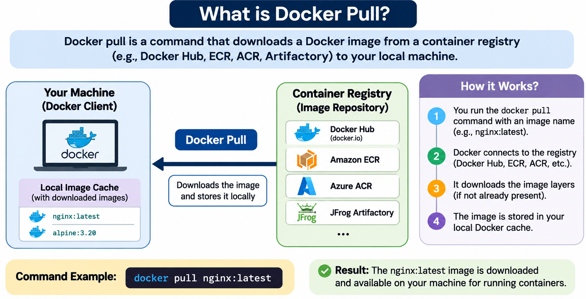

# Understanding docker pull `docker.io/library/ubuntu:latest`



The command **`docker pull docker.io/library/ubuntu:latest`** fetches the Ubuntu image (specifically the **`:latest`** tag) from the Docker Hub default registry (**`docker.io`**). By default, if you do not specify a registry or fully qualify the image name, Docker assumes it is hosted on Docker Hub.

### Pulling Images from Other Registries

**1. Pulling Images from AWS Elastic Container Registry (ECR):**

```
docker pull <repository-uri>:<tag>
docker pull 1234567890.dkr.ecr.us-east-1.amazonaws.com/my-app:v1.0
```

- **<repository-uri>:** The URI for your private repository hosted in ECR.
- **<tag>:** The version or tag of your image (e.g., v1.0).

**AWS ECR URIs** follow the format:

```
<account-id>.dkr.ecr.<region>.amazonaws.com/<repository-name>:<tag>
```

2. Pulling Images from Google Container Registry (GCR):

```
docker pull gcr.io/<project-id>/<image-name>:<tag>
docker pull gcr.io/my-gcp-project/my-app:v1.0
```

- <project-id>: The Google Cloud project where your container registry resides.
- <image-name>: The name of your image.
- <tag>: The version or tag of your image.

GCR URIs follow the format:

```
gcr.io/<project-id>/<image-name>:<tag>
```

## Key Takeaways:
- The docker pull command works similarly across all registries, with the main difference being the fully qualified path (registry URI) to the image.
- Make sure to authenticate with the registry (e.g., AWS ECR or GCR) before pulling private images.
- Docker daemon prefixes **`docker.io/library/`** for default images on Docker Hub when no registry is specified.

## Important Docker Commands

**1. Listing Images**

To view all downloaded images on your local system:

```
docker images
```

**2. Listing Containers (Running and Stopped)**

To list all containers (including stopped ones):

```
docker ps -a
```

**3. Removing Images**

To remove an image locally:

```
docker rmi <image-name>:<tag>
docker rmi ubuntu:latest
```
To force remove an image (use with caution):

```
docker rmi -f <image-name>:<tag>
```
**4. Cleaning Up Unused Docker Resources**

A comprehensive command to remove all stopped containers, dangling images, unused networks, and build cache:

```
docker system prune -a
```

**5. Tagging an Image**

To assign a version to your image:

```
docker tag [OPTIONS] IMAGE [REGISTRYHOST/][USERNAME/]NAME[:TAG]
docker tag my-image:latest my-registry/my-image:v1.0
```

**6. Building an Image from a Dockerfile**

To build an image from a Dockerfile:

```
docker build [OPTIONS] PATH | URL | -  
docker build -t my-image:v1.0 .
```

**7. Pushing an Image to Docker Hub**

To push an image to Docker Hub:

```
docker push docker.io/<username>/<imagename>:<tag>
docker push my-image:v1.0
```

**8. Running a Container**

To run a container from an image:

```
docker run [OPTIONS] IMAGE [COMMAND] [ARG...]
docker run my-image:v1.0
```

### Contributors
[![Yogendra Pratap Singh][yogendra_avatar]][yogendra_homepage]<br/>[Yogendra Pratap Singh][yogendra_homepage] 

  [yogendra_homepage]: https://www.linkedin.com/in/yogendra-pratap-singh-41630716b/
  [yogendra_avatar]: https://img.cloudposse.com/75x75/https://github.com/PratapSingh13.png