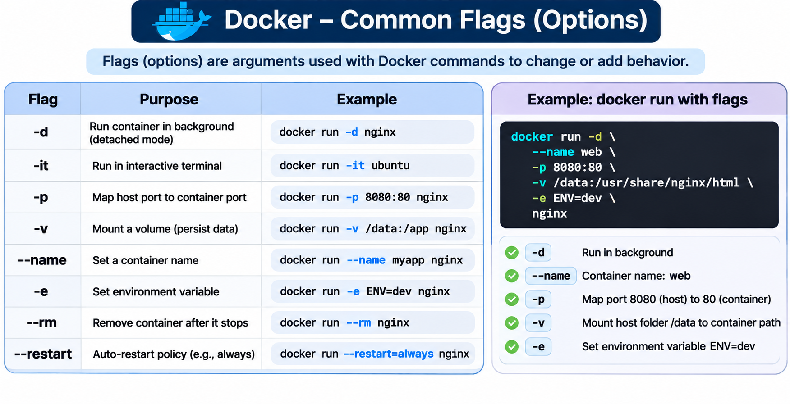

# Understanding docker flags, deep dive into Dockerfile and exposing containers



```
docker run -d -p 8080:80 --name nginx-container nginx
```

This command performs several key actions:

1. **Detached Mode (-d)**: Runs the container in the background, freeing up your terminal for other tasks.

2. **Port Mapping (-p 8080:80)**: Maps port 80 in the container (default Nginx port) to port 8080 on your host machine.
3. **Container Name (`--name nginx-container`)**:
Assigns the container the name `nginx-container` for easier identification and management.
Once this command is executed, you can access the Nginx default page by opening http://localhost:8080 in your browser.

## Dockerfile Instructions and Their Purposes

| Instruction | Purpose |
|-------------|---------|
| **`FROM`** | Defines the base image to build your application. Example: `FROM python:3.9-slim` |
| **`WORKDIR`** | Sets the working directory for subsequent instructions. Example: `WORKDIR /app` |
| **`ADD`** | Copies files/directories from the host to the container and automatically extracts archives (e.g., `.tar.gz`). Example: `ADD app.tar.gz /app` |
| **`COPY`** | Similar to ADD but only copies files/directories (no extraction or URL handling). Example: `COPY app.py /app/app.py` |
| **`RUN`** | Executes commands during the image build process. Example: `RUN pip install -r requirements.txt` |
| **`EXPOSE`** | Informs Docker that the container listens on the specified ports. Note: It doesn’t actually open the port; you need to use the -p flag when running the container. Example: `EXPOSE 8000` |
| **`CMD`** | Defines the **default command** to execute when a container is started from the image. This can be overridden with `docker run <image-name> <command>`. Example: `CMD ["python", "app.py"]` |
| **`ENTRYPOINT`** | Defines the command that will always execute when the container starts. You can append arguments via `docker run <image-name> <arguments>`. To completely override this, use the `--entrypoint` flag. Example: `ENTRYPOINT ["nginx", "-g", "daemon off;"]` |

## Example Dockerfile

Below is an example of a `Dockerfile` that builds a lightweight Python Flask application:

```dockerfile
# Use the official lightweight Python image
FROM python:3.9-slim

# Set the working directory inside the container
WORKDIR /app

# Copy the requirements file and install dependencies
COPY requirements.txt .
RUN pip install --no-cache-dir -r requirements.txt

# Copy the rest of the application code
COPY . .

# Expose the port the app runs on
EXPOSE 5000

# Define the command to run the application
CMD ["python", "app.py"]
```

### Contributors
[![Yogendra Pratap Singh][yogendra_avatar]][yogendra_homepage]<br/>[Yogendra Pratap Singh][yogendra_homepage] 

  [yogendra_homepage]: https://www.linkedin.com/in/yogendra-pratap-singh-41630716b/
  [yogendra_avatar]: https://img.cloudposse.com/75x75/https://github.com/PratapSingh13.png