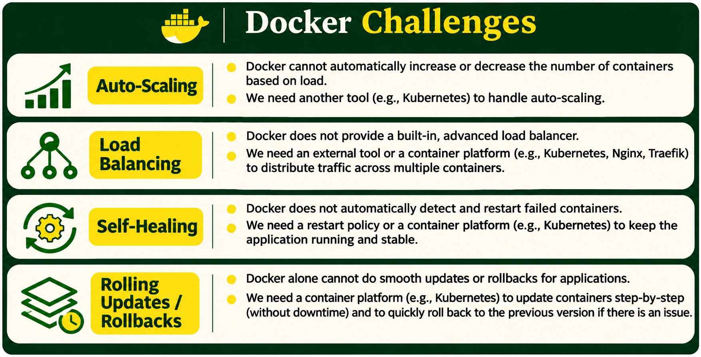
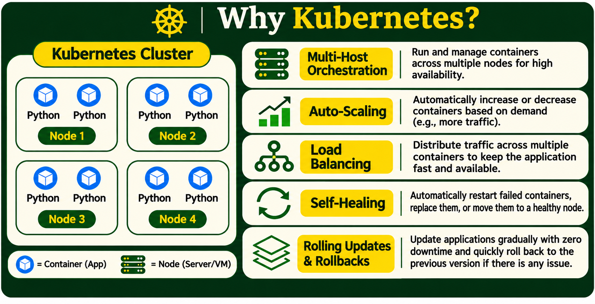

# Docker vs Kubernetes

## Challenges with Docker

- **Auto-Scaling:** Docker lacks native support for automatic scaling of containers based on resource utilization or demand, requiring external orchestration tools like Kubernetes to manage dynamic scaling effectively.

- **Load Balancing:** Docker does not offer built-in, sophisticated load-balancing mechanisms across multiple containers or hosts, making it reliant on third-party tools or manual configurations.

- **Self-Healing:** Docker does not have inherent self-healing capabilities to restart failed containers or maintain application stability automatically, unlike Kubernetes.

- **Rolling Updates/Rollbacks:** Docker alone cannot perform seamless rolling updates or rollbacks for applications, which is essential for maintaining zero downtime during updates or reverting changes safely.

## Hello Kubernetes

### Kubernetes vs Docker Swarm

|**Features**                   | **Kubernetes** | **Docker Swarm** |
|:-----------------------------:|:----------:|:-----------------:|
| **Installation & Cluster Config** | Setup is very complicated, but once installed cluster is robust. | Installation is very simple, but the cluster is not robust.|
| **GUI** | GUI is the Kubernetes Dashboard. | There is no GUI.|
| **Scalability** | Highly scalable and scales fast. | Highly scalable and scales 5x faster than Kubernetes. |
| **Auto-scaling** | Kubernetes can do auto-scaling. | Docker swarm cannot do auto-scaling. |
| **Load Balancing** | Manual intervention needed for load balancing traffic between different containers and pods.	 | Docker swarm does auto load balancing of traffic between containers in the cluster. |
| **Rolling Updates & Rollbacks** | Can deploy rolling updates and does automatic rollbacks. | Can deploy rolling updates, but not automatic rollback. |
| **Logging & Monitoring** | In-built tools for logging and monitoring.	| 3rd party tools like ELK stack should be used for logging and monitoring.|

### Contributors
[![Yogendra Pratap Singh][yogendra_avatar]][yogendra_homepage] [Yogendra Pratap Singh][yogendra_homepage] 

  [yogendra_homepage]: https://www.linkedin.com/in/yogendra-pratap-singh-41630716b/
  [yogendra_avatar]: https://img.cloudposse.com/75x75/https://github.com/PratapSingh13.png